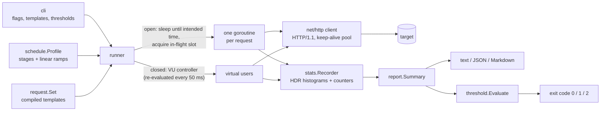

# loadgen

[](https://github.com/rahulkumar96t/loadgen/actions/workflows/ci.yml)

`loadgen` is a small HTTP load generator written in Go with only the standard library. It
drives load in two ways. The open model sends requests at a fixed arrival rate from a
precomputed schedule. The closed model runs N virtual users. In the open model, latency is
measured from each request's **intended** send time, so a server that stalls cannot hide
behind a generator that slowed down with it (the problem known as *coordinated omission*).
Results go into a log-linear histogram implemented in this repo, are summarised as text,
JSON or Markdown, and can be checked against thresholds such as `--fail-if 'p99>250ms'`
that set the exit code for CI.

## Features

- **Open model**: constant or staged arrival rate. Send times come from the rate profile
  (`--rate`, `--stage 30s:200rps`). Each request records its intended time, the actual
  send time and the completion time.
- **Closed model**: N virtual users (`--vus`, `--stage 30s:50vu`) with optional think time.
- **Ramp stages**: each stage ramps linearly from the previous target to its own target.
  Stages can ramp up, hold, ramp down or pause at zero.
- **Request templates**: method, URL, headers and body from flags or a JSON file, with
  weighted round-robin across templates. Placeholders: `{{seq}}`, `{{uuid}}`, `{{unix}}`,
  `{{unix_ms}}`, `{{env:NAME}}`.
- **HDR-style histogram**: log-linear buckets, 1–5 significant digits, bounded relative
  error, mergeable. Reports min, mean, p50, p90, p99, p99.9 and max.
- **Three distributions in the open model**: latency (from the intended time), service time
  (from the actual send) and send lag (how late the generator was).
- **Accounting**: per-status-code counts, transport errors by class (`timeout`,
  `connection_refused`, `connection_reset`, `dns`, `tls`, `eof`, ...) and *unsent* requests
  (the in-flight cap was reached before the schedule ended).
- **Reports**: terminal summary, `--out-json`, `--out-md` (`-` writes to stdout).
- **CI thresholds**: `--fail-if` on percentiles, mean/min/max, `service.*`, `lag.*`,
  `error_rate`, `rps`, `unsent`, `failed`. A breach exits with code `2`.
- **Demo server** with configurable latency, jitter, error rate and periodic stalls.

## Architecture



| Package | Responsibility |
|---|---|
| `internal/schedule` | Stage parsing, piecewise-linear profiles, intended send offsets (closed-form inversion of the rate integral) |
| `internal/runner` | Open-model dispatcher with in-flight cap, closed-model VU controller, HTTP client setup, injectable clock |
| `internal/hist` | Log-linear histogram: record, quantiles, merge, saturation |
| `internal/stats` | Thread-safe recorder, error classification, expected-status sets |
| `internal/request` | Template compilation, placeholders, weighted selection, JSON loader |
| `internal/threshold` | `--fail-if` parsing and evaluation |
| `internal/report` | Summary building, JSON, Markdown and text rendering |
| `internal/demo`, `cmd/demoserver` | Demo target |
| `internal/cli`, `cmd/loadgen` | Command line |

## Quickstart

Requires Go 1.23 or newer.

```sh
make build                      # builds bin/loadgen and bin/demoserver
./bin/demoserver --latency 5ms --jitter 5ms &
./bin/loadgen --rate 200 --duration 10s http://127.0.0.1:8099/
make demo                       # closed vs open model against a stalling server
make test                       # go test -race ./...
```

## Usage

```sh
# Open model, constant rate
loadgen --rate 500 --duration 1m http://localhost:8080/api/items

# Ramp 0 -> 300 rps over 30 s, hold for 2 min, ramp down over 10 s
loadgen --stage 30s:300rps --stage 2m:300rps --stage 10s:0rps http://localhost:8080/

# Closed model: 50 users with 200 ms think time, ramped up over 20 s
loadgen --stage 20s:50vu --stage 1m:50vu --think 200ms http://localhost:8080/

# POST with headers, a templated body and a secret read from the environment
loadgen --rate 100 --duration 30s -X POST \
  -H 'Content-Type: application/json' -H 'Authorization: Bearer {{env:API_TOKEN}}' \
  -d '{"id": {{seq}}, "request_id": "{{uuid}}"}' http://localhost:8080/orders

# Several weighted templates (see examples/requests.json)
loadgen --requests examples/requests.json --rate 200 --duration 30s

# CI gate: exit 2 if p99 > 250 ms or more than 1% of requests fail; keep both reports
loadgen --rate 100 --duration 30s \
  --fail-if 'p99>250ms' --fail-if 'error_rate>1%' --fail-if 'unsent>0' \
  --out-json report.json --out-md report.md http://staging.internal/health

# Treat 404 as success, gate on the server-side view only
loadgen --rate 50 --duration 20s --expect-status 200-299,404 --fail-if 'service.p99>100ms' URL
```

Main flags (run `loadgen --help` for all of them):

| Flag | Default | Meaning |
|---|---|---|
| `--rate R`, `--duration D` | – , `10s` | open model at R requests/second |
| `--vus N` | – | closed model with N virtual users |
| `--stage D:T[rps\|vu]` | – | ramp stage, repeatable; `--start` sets the value the first stage ramps from |
| `--max-inflight N` | `1000` | open model concurrency cap (`0` = unlimited) |
| `--think D` | `0` | closed model pause between requests |
| `--timeout D` | `10s` | per request, including reading the body |
| `--expect-status S` | `200-399` | statuses counted as success |
| `--fail-if EXPR` | – | threshold, repeatable (`p99>250ms`, `p99.9>1s`, `error_rate>1%`, `rps<95`, `lag.p99>5ms`) |
| `--sig-digits N` | `3` | histogram precision (1–5) |

Exit codes: `0` success, `1` usage or start-up error, `2` at least one threshold breached.

The demo server takes `--latency`, `--jitter`, `--error-rate`, `--stall-every`,
`--stall-for` and `--body-size`. Per request, `?latency=50ms&status=404` overrides them.

## Coordinated omission

A closed-loop tester waits for each response before it sends the next request. When the
server freezes for 300 ms, each virtual user records one slow request and then sends nothing
for the rest of the freeze. The requests that real users would have sent during that time
never happen, so they are never measured. The tester has coordinated with the server to omit
its worst moments. An open-model tester keeps sending on schedule. If it has to send late
(for example because of a connection cap), `loadgen` charges the wait to the request by
measuring latency from the intended send time.

Output from `make demo` on an Apple M4 Pro (macOS, Go 1.27.3). Both runs hit the same
demo server, which has 5–10 ms latency and freezes for 300 ms every 3 s. This was over
loopback, so it shows the measurement effect and is **not** a benchmark of anything.
The output is abridged.

```
== closed model: 10 virtual users, 15s
elapsed 15.01s  scheduled 17358  sent 17358  unsent 0  completed 17358  failed 0 (0.00%)  throughput 1156.7 rps

ms                min       mean        p50        p90        p99      p99.9        max
service         5.106      8.641      7.803      9.798     10.330    305.922    309.370

== open model: 1000 requests/second, 15s
elapsed 15.01s  scheduled 15000  sent 15000  unsent 0  completed 15000  failed 0 (0.00%)  throughput 999.5 rps

ms                min       mean        p50        p90        p99      p99.9        max
latency         5.151     22.987      8.155     12.001    279.446    306.184    312.496
service         5.117     22.860      8.036     11.731    279.183    306.184    312.233
send lag        0.003      0.128      0.127      0.177      0.385      2.472      4.706

threshold FAIL  p99>250ms            actual 279.446 ms
threshold PASS  error_rate>1%        actual 0.00%
open-model exit code: 2 (2 = a --fail-if threshold was breached)
```

The closed model reports a p99 of about 10 ms. The server was frozen for 10% of the time,
and the open model correctly reports a p99 of about 280 ms.

The open model also exposes the effect when the *generator* is the bottleneck. This run
used a single connection (`--rate 50 --duration 15s --max-inflight 1`) against the same
server on the same machine (abridged):

```
ms                min       mean        p50        p90        p99      p99.9        max
latency         6.203     35.453     10.281    133.628    289.145    300.523    300.523
service         5.265     10.605      8.667     10.797     11.960    299.434    299.434
send lag        0.020     24.848      1.048    113.639    269.222    280.576    280.576
warning: send lag p99 is 269.2 ms: requests left the generator late (in-flight limit reached or generator CPU-bound); latency is still measured from the intended time
```

Service time, which is what a naive tool reports, gives a p99 of 12 ms. The requests queued
behind the frozen one waited up to 280 ms to be sent, and the latency column includes that
wait.

## Design decisions and trade-offs

- **The schedule is a pure function.** The n-th request is due at the time where the
  integral of the rate profile equals n. For a linear ramp this is a quadratic, solved in a
  numerically stable form. Send times are absolute offsets from the start, not ticker
  intervals, so lateness never accumulates into drift. The request count is exact (a
  10 s run at 100 rps sends exactly 1000 requests). The dispatcher can also be tested in
  virtual time through an injectable clock.
- **Block instead of drop.** When `--max-inflight` is reached, the dispatcher waits for a
  free slot. Late requests are still sent, and their wait counts towards latency and send
  lag. Requests that still have no slot when the profile ends are counted as `unsent` and
  produce a warning, and `--fail-if 'unsent>0'` can gate on them. The cap exists because
  an unlimited generator facing a frozen server just runs out of file descriptors.
- **A goroutine per request** rather than a fixed worker pool. The semaphore bounds
  concurrency, and the Go scheduler makes this cheap and simple. Connection reuse comes
  from sizing `MaxIdleConnsPerHost` to the concurrency, because the default of 2 would
  churn connections.
- **The histogram reports the upper edge of the bucket** (clamped to the observed max), so a
  percentile is never under-reported and is over-reported by less than 10^-digits. At
  3 digits with a 1 h range in nanoseconds, it uses 33,421 counters (about 261 KiB).
  Recording costs about 3.9 ns and makes no allocations (`go test -bench Record ./internal/hist`
  on the machine above). Values above 1 h are clamped and reported as saturated.
- **One mutex-protected recorder.** This is simple and correct, and it is not a bottleneck
  at the rates exercised here. `Histogram.Merge` exists, so per-worker histograms merged at
  the end would be a straightforward change if profiling ever showed contention.
- **HTTP/1.1, no redirects followed.** A 3xx is reported as such. HTTP/2 multiplexing
  would change the meaning of "connection" and "in-flight", so it is left out on purpose.
- **Error rate** = failed / completed, where *failed* means a transport error or a status
  outside `--expect-status`. Unsent requests are reported separately because they say more
  about the offered load than about the server.
- **Closed-model ramps** re-evaluate the target VU count every 50 ms and round it to the
  nearest integer. When a VU is removed, it finishes its current request first.
- **Standard library only.** There is nothing to vet in `go.sum`, and the binary builds
  anywhere Go 1.23 runs.

## Testing

```sh
go vet ./... && go test -race ./...
```

| Area | What is checked |
|---|---|
| Histogram | Property test over uniform, exponential, log-normal, bimodal and tiny-value distributions at 1–4 digits. Every percentile is >= the exact nearest-rank value and within 10^-digits of it. Also bucket bounds, monotonic indexing, merge equivalence, saturation |
| Schedule | Exact spacing at constant rate, per-second counts on ramps against the analytic integral, ramp-up/hold/ramp-down, zero-rate pauses, stage parsing |
| Runner | Dispatcher in virtual time (7,500 requests over a 20 s ramp profile, checked per second, runs in about 60 ms). Real-time 200 rps accuracy against `httptest`. Coordinated-omission test (a 500 ms stall must move intended-time p90 above 150 ms while service-time p90 stays below 100 ms). Unsent accounting, connection-refused errors, closed-model concurrency limits, think time, cancellation |
| Thresholds and reports | Expression parsing and evaluation, JSON fields, golden Markdown file (`go test ./internal/report -update` regenerates it), text summary |
| CLI | End-to-end runs against the demo handler: report files, exit code 2 on latency and error-rate breaches, `--expect-status`, templates file, closed model, usage errors |

On the machine above, `go test -race -count=3 ./...` takes about 17 s of wall time. The
timing-sensitive tests use wide tolerances. They also passed with `-race -count=3 -cpu=1,2`
while ten busy-loop processes competed for the CPU, and the whole suite passed under the
Go 1.23.12 toolchain (`GOTOOLCHAIN=go1.23.12`), which matches the version CI installs.

## Limitations and roadmap

- Single process only. A distributed mode would merge histograms from several workers.
- HTTP/1.1 only. No HTTP/2, HTTP/3, gRPC or WebSocket.
- No per-template breakdown when several request templates are used.
- End-of-run summary only. There is no per-second time series of percentiles yet.
- Response checks are limited to the status code (no body assertions).
- No data feeding from CSV files.
- At very high rates (send intervals well below 100 µs), OS timer granularity limits how
  precisely the schedule is followed. Send lag makes this visible, but nothing corrects it.
- Not measured beyond loopback on one laptop. Validate the generator's own limits (CPU,
  ephemeral ports, file descriptors) before trusting it for large tests.

## License

MIT, see [LICENSE](LICENSE).
